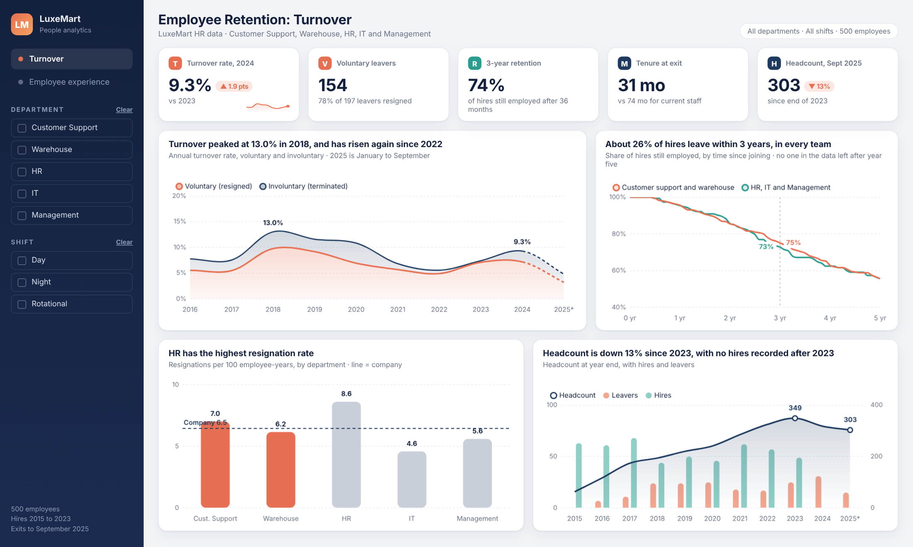
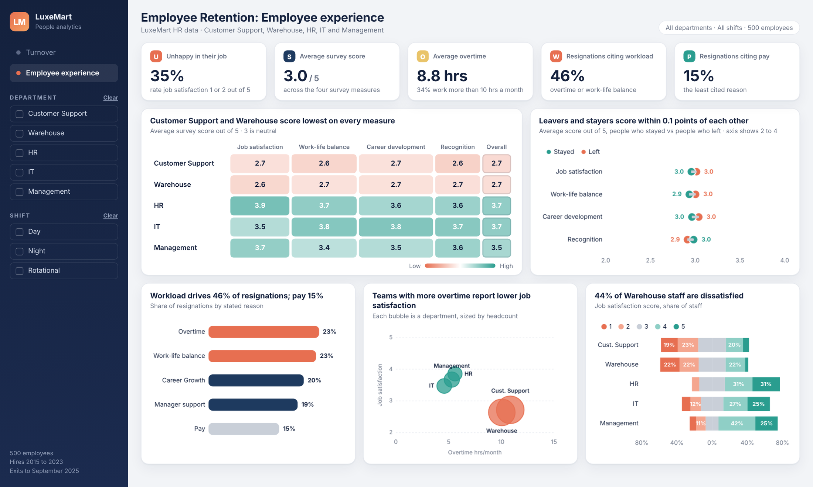
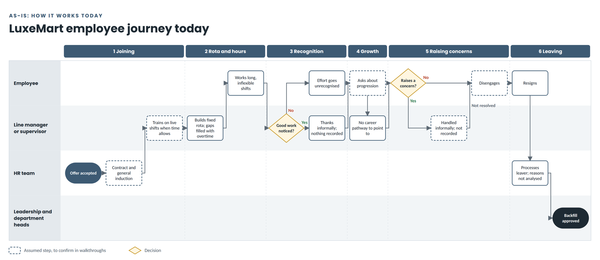
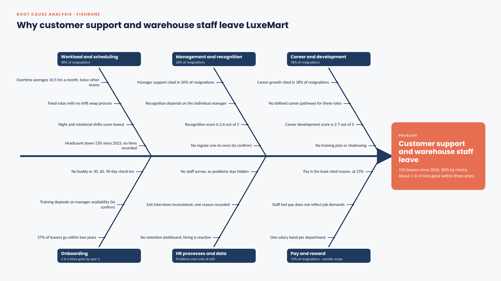
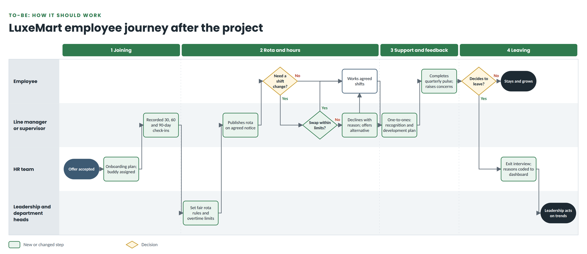
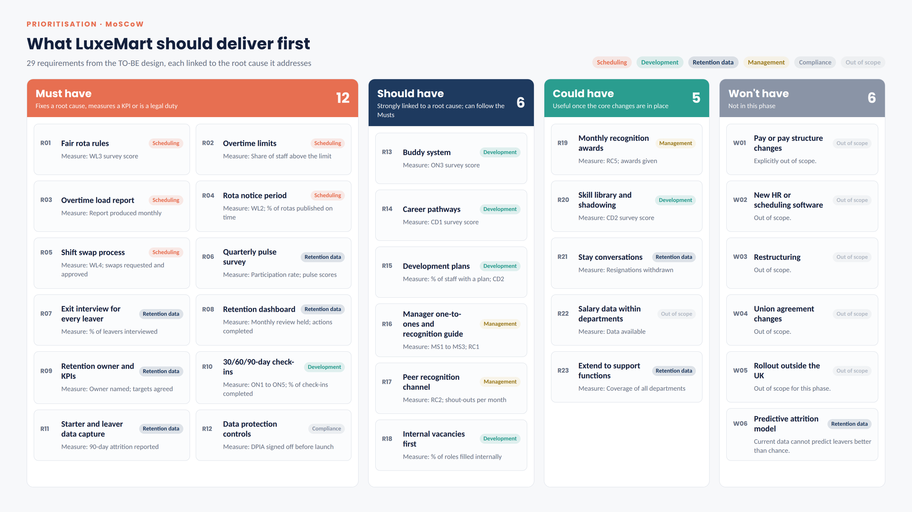
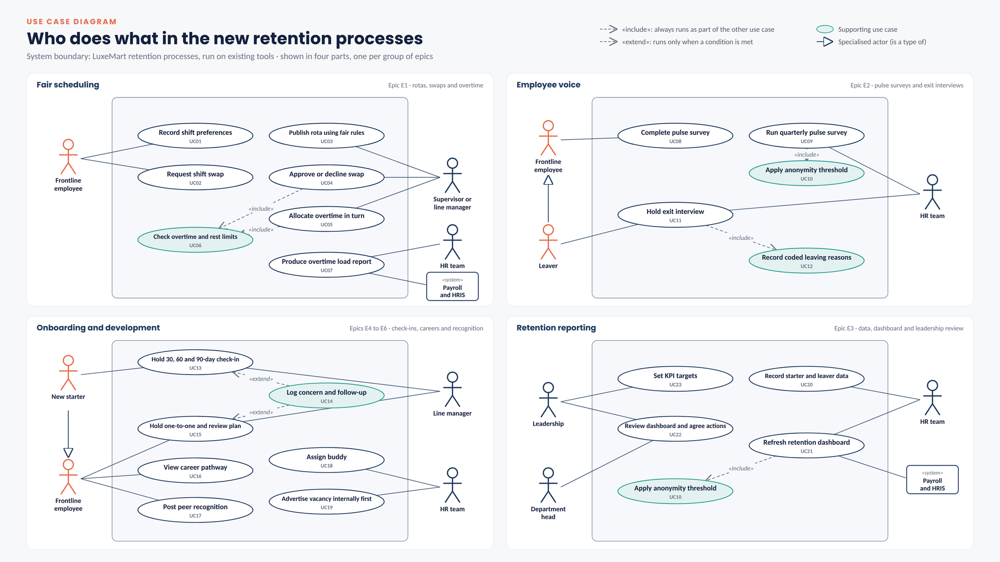
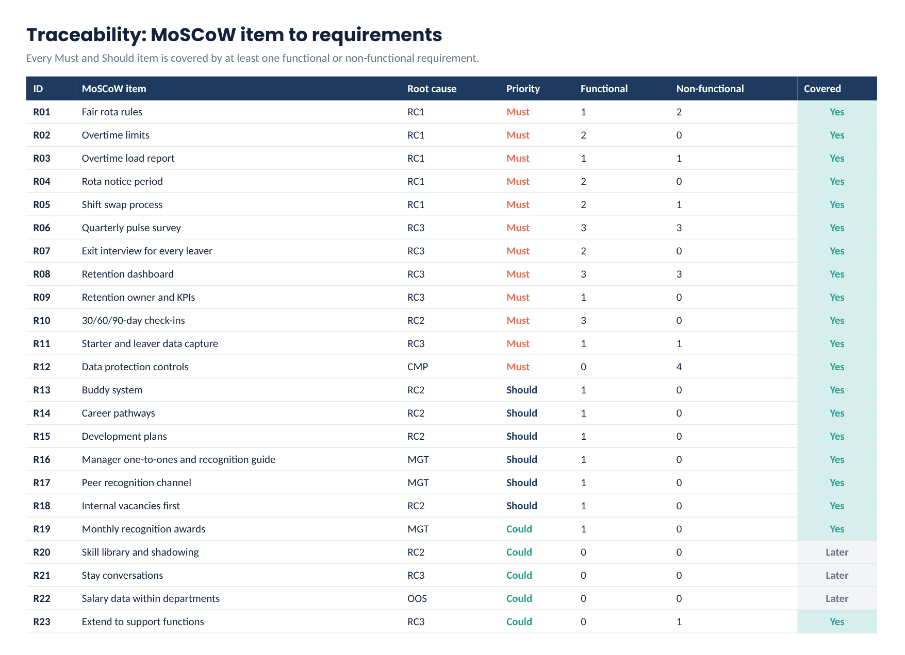
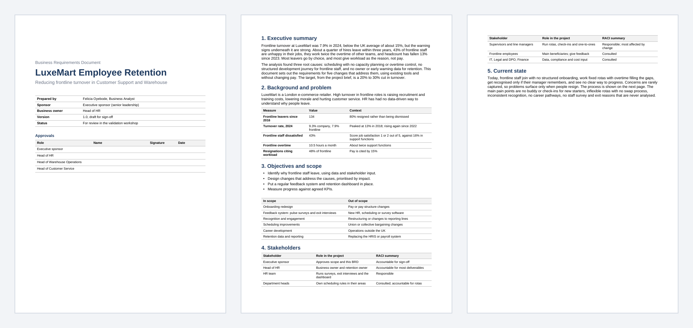

# LuxeMart Employee Retention: A Business Analysis Case Study

> **In short:** LuxeMart believed its customer support and warehouse turnover was high. I found it was moderate (7.9%, below the UK average) but with strong warning signs: 43% dissatisfied, twice the overtime of other teams and 1 in 4 hires gone within three years. I traced three root causes and turned them into 29 prioritised requirements, a Jira backlog, a BRD and a 12-month roadmap.
>
> **My role:** solo business analyst. The brief and dataset were provided as part of a case study; all analysis, documentation and the dashboard are my own work.

### You can interact with the live dashboard [HERE](https://lolabode.github.io/luxemart-employee-retention/)

## Introduction

LuxeMart is a London e-commerce retailer (a fictional company). Its brief was simple: customer support and warehouse staff keep leaving, and HR doesn't know why.

I treated it like a real three-week engagement. First I understood the people and processes. Then I tested what the data really says, found the root causes, and designed and prioritised the fix. This README shows how I did it, what I found, and where my analysis has limits.

## The Case Study Question

**Why are LuxeMart's customer support and warehouse staff leaving, and what can LuxeMart change to keep them?**

1. How big is the problem?
2. Who is most affected?
3. Why do they leave?
4. When do they leave?
5. Can LuxeMart see it coming?
6. What should change, and how will we know it worked?

**Scope:** UK only, customer support and warehouse teams, no pay changes and no new software.

## Key Findings

| | |
|---|---|
| **7.9%** | Turnover in 2024, below the UK average of about 15% (CIPD, 2025), but rising |
| **43%** | Rate their job satisfaction 1 or 2 out of 5 (16% in HR, IT and Management) |
| **48%** | Of resignations cite overtime or work-life balance; only 15% cite pay |
| **10.5 hrs** | Average overtime per person per month, about twice other teams |
| **1 in 4** | Hires gone within three years |

*The dashboard opens on all departments (46% of resignations cite workload). Filter to Customer Support and Warehouse to see the 48% quoted above.*

<b>What the findings really mean (and where I had to be honest)</b>

### Turnover is moderate, not a crisis
The brief said turnover was high. A UK benchmark showed it was below average, so I reframed the story around the warning signs underneath it.

### They are the least satisfied, but not yet leaving faster
HR, IT and Management actually had higher turnover in 2024 (12.3%). I nearly presented "frontline staff leave the most" as a finding, until checking it properly showed it wasn't true.

### Workload is the main stated reason
48% of leavers named overtime or work-life balance. This is what people said when they left, not proven cause and effect.

### People leave early
About 1 in 4 hires are gone within three years. I used a retention curve rather than a simple count, so that people still employed were included fairly.

### The data cannot predict who will leave
Leavers and stayers scored almost the same. Survey scores were undated and each leaver had only one exit reason recorded. A predictive model performed no better than chance. That gap became a recommendation.

### Limits I flagged
- No hires were recorded after 2023, which flatters the 2024 turnover rate.
- A 20 to 30% cut in turnover means only 4 to 5 fewer leavers a year, so results should be judged over two years.

## AS-IS Process

A concern raised with a manager goes nowhere. HR first hears about a problem when someone resigns. Dashed steps are assumptions to confirm with supervisors.

## Root Cause Analysis

I used a fishbone for breadth, mapping every cause by category, and five whys for depth, drilling down to the root causes.

**Three root causes:**
1. Scheduling has no capacity planning, fairness rules or overtime monitoring
2. There is no structured development journey from onboarding to promotion
3. Retention has no owner, KPIs or early warning data

Two links in the five whys chains are assumptions and need validating in a workshop.

## TO-BE Process

The future journey adds control points (fair rota rules, a swap process, overtime limits) and early warning (check-ins, a pulse survey, exit interviews and a monthly leadership review).

## How I Approached It

<b>Stakeholder analysis and RACI</b>

I identified 14 stakeholder groups and placed them on a power-interest grid. I then built a RACI across 22 project activities, so every task had exactly one person accountable. The scores were my own judgement from the brief, so I would test them at kickoff in a live project.

<b>Requirements elicitation</b>

There were no live interviews, so I elicited requirements from the project brief and the 500-employee HR dataset. To fill the evidence gap, I designed an employee satisfaction survey, a 10-question quarterly pulse survey and interview questions for each stakeholder group. Every assumed process step is clearly marked.

<b>Requirements, use cases and prioritisation</b>

- **MoSCoW:** 29 requirements. 12 Must (52% of in-scope items), 6 Should, 5 Could and 6 Won't.
- **Requirements:** 28 functional and 17 non-functional, covering UK GDPR, working time rules, accessibility and data quality.
- **Use cases:** 23 use cases across 8 actors.
- **User stories:** 29 stories with 62 acceptance criteria in Given, When, Then format.
- **Testing:** 24 UAT test scenarios.

**Traceability:** every requirement links back to a root cause and forward to a test.

## Business Documentation

| Document | What it covers |
|---|---|
| Business Requirements Document (BRD) | Problem, scope, stakeholders, AS-IS and TO-BE, root causes, requirements, recommendations, KPIs, risks |
| Retention Strategy and KPIs | 5 recommendations, 12-month roadmap, risk register, 17 KPIs with baselines and targets |
| Employee Satisfaction Survey | Baseline survey and a 10-question quarterly pulse, each question linked to a pain point |
| Requirements Workbook | MoSCoW, functional and non-functional requirements, traceability |
| Risks, Assumptions and Test Scenarios | Risk register, assumptions log, 24 UAT scenarios |
| Stakeholder Presentation | The case study story, from question to recommendations |

## Product Backlog in Jira

I turned the requirements into a Jira backlog: 6 epics and 29 user stories, each with acceptance criteria and a MoSCoW priority, ready for a delivery team to pick up.

## Recommendations

1. **Confirm a hiring plan first,** then set overtime limits and fair rota rules. Headcount is down 13%, so limits alone would leave rotas uncovered.
2. **Name a retention owner** and launch a quarterly pulse survey and exit interviews.
3. **Validate the root causes** with staff and managers before signing off the BRD.
4. **Ask Finance for the cost per hire,** so the savings can be calculated rather than guessed.
5. **Introduce recorded 30, 60 and 90-day check-ins** and regular manager one-to-ones.
6. **Publish career pathways** and advertise vacancies internally first.

## Business Value

The turnover target (a 20 to 30% reduction, from the brief) means about 4 to 5 fewer leavers a year. Once Finance confirms the cost per hire, the saving is simple: fewer leavers × cost per hire, plus training time saved. I deliberately didn't estimate a cost, because the data didn't include one.

## What I Would Do Differently

- **Run real stakeholder interviews** to replace the assumed process steps.
- **Find a turnover benchmark on day one,** because it changed my whole narrative.
- **Draft the KPI table in week one** and refine it as the data came in.

## Lessons Learned

The biggest lesson was to question the brief. It said turnover was high, but the data said turnover was moderate with strong warning signs. Reporting what the data showed, including what it couldn't show, made the recommendations more credible.

I also learned to keep diagrams simple for non-technical audiences. My first use case diagram was unreadable, so I split it into four panels. My fishbone colour tags confused people, so I removed them.

## Tools and Skills

**Business analysis:** stakeholder analysis, RACI, process mapping, root cause analysis, MoSCoW, BRD, functional and non-functional requirements, use cases, user stories, acceptance criteria, UAT, risk management, KPI design

**Tools:** Jira, Excel, Python, HTML and Chart.js, draw.io, Word, PowerPoint

## Files in This Repository

- `index.html`: live interactive dashboard
- `documents/`: BRD, retention strategy and KPIs, employee satisfaction survey
- `presentation/`: stakeholder presentation
- `analysis/`: Excel workbooks (stakeholder analysis, data analysis, MoSCoW, requirements, user stories, risks and test scenarios)
- `editable-diagrams/`: draw.io source files

## Note on the Data

The HR dataset is fictional and is not included in this repository.
